

# VeLinux KÖLE

**A cheap F133 smart display, rebuilt from scratch into a Linux voice & Telegram home assistant.** 
**Ucuz bir F133 akıllı ekran; sıfırdan Linux'a geçirilip sesli ve Telegram'lı bir ev asistanına dönüştürüldü.**

RISC-V · 64 MB RAM · 16 MB SPI-NOR · Linux 5.4 · Go + C · LVGL · Gemini · Telegram · Tailscale

**[English](#english)** · **[Türkçe](#türkçe)** · [Screenshots / Ekran görüntüleri](#screenshots--ekran-görüntüleri) · [Firmware & recovery / Kurtarma](firmware/README.md) · MIT

 

**▶ [Watch the 1-minute project video / 1 dakikalık tanıtım videosunu izle](docs/media/velinux-kole-tanitim.mp4)**

 

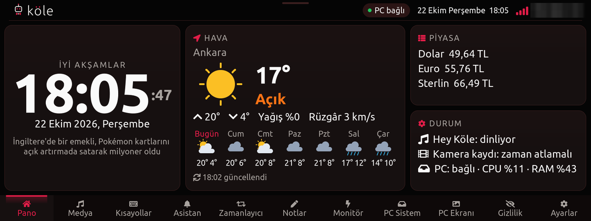

---

# English

**Contents:** [What it is](#what-it-is) · [Features](#features) · [Hardware](#hardware) · [Architecture](#architecture) ·
[Boot & flash](#boot-and-flash-layout) · [Components](#components) · [Engineering notes](#engineering-notes) ·
[Repository layout](#repository-layout) · [Building & installing](#building-and-installing) · [Safety](#safety-rules) ·
[By the numbers](#by-the-numbers)

## What it is

The board is an inexpensive Allwinner **F133** smart display (1600×600 touch screen, USB camera, speaker, Bluetooth
audio chip). It shipped with a closed **Melis** RTOS firmware. VeLinux replaces that firmware with a custom
**Linux 5.4** system that boots from the on-board 16 MB SPI-NOR flash and runs a complete home assistant in about
**55 MB of usable RAM** — no cloud service of its own, no extra hardware.

Everything runs on the device: the Telegram bot, the voice assistant, the camera recorder, the web hub and the touch UI.
The only outside services are the APIs it calls (Gemini, Telegram, weather/currency/news) and Tailscale for remote
access. A Windows PC is optional: it can act as a "second screen" source and as a desktop companion.

## Features

### 🎙️ Voice assistant — "Hey Köle"
- On-device wake word ("Hey Köle"), recording, then a spoken answer.
- Answers come from **Gemini**; several models are raced with fallback, so a busy model does not block the reply.
- Speech: Gemini TTS, with **ElevenLabs** as fallback when the daily TTS quota runs out.
- A short pre-buffer before playback so the amplifier is awake when speech starts.
- Personality: the assistant is "Köle" and answers politely ("efendim").

### 💬 Telegram bot
A persistent button menu plus slash commands:

| Command | What it does |
|---|---|
| `/menu` | Show the button menu |
| `/durum` | Weather, camera and service status |
| `/foto` | Take a photo now |
| `/canli` | Live camera link |
| `/bekci` | Guard mode: motion alerts |
| `/zaman` | Time-lapse recording |
| `/cerceve` | Digital photo frame |
| `/haber` | News (incl. a cyber-security digest) |
| `/sabah` | Morning summary |
| `/saglik` | Device health |
| `/ses` | Voice and speaker settings |
| `/heykole` | Turn wake-word listening on/off |
| `/sehir` | City for the weather |
| `/jp` | Ask questions about a document/web page (answers only from that page, with a link to the section) |
| `/yardim` | All commands with examples |

- Plain text is a question to the assistant; replies keep the menu open.
- **Allow-list** for extra users (e.g. family): each user gets replies in their own chat; important alerts go to everyone.
- Health, out-of-memory and motion alerts are pushed automatically.
- Built for 64 MB: a tiny C process keeps the Telegram long-poll open over **BearSSL**; the Go assistant only starts
  for each message and exits.

### 📷 Camera
- USB camera with motion detection (motion score per minute), guard-mode alerts with a photo.
- Recording to SD in parts, **time-lapse** (selectable interval, kept 30 days), photo frame mode.
- **RTSP** server with digest authentication; live view in Telegram, the web hub and the PWA.
- Privacy shield: camera and microphone can be locked off from the panel; every view is written to an audit log.

### 🖐️ Touch panel UI
Written in C with **LVGL 9.2** directly on the framebuffer (G2D rotation, no X/Wayland). Tabs:
**Home** (clock, weather, currency, status) · **Media** (PC media keys, Bluetooth phone) · **Shortcuts** ·
**Assistant** · **Timer** · **Notes** · **Monitor** (CPU/memory) · **PC System** (live PC stats) · **PC Screen** ·
**Privacy** · **Settings**. A pull-down control center, themes (red/black, blue, white), night mode, panel lock,
screen savers (clock, logo, info, words, world, stars, aurora) and animated "robot eyes".

### 🌐 Merkez — web hub and PWA
- HTTPS hub running on the device (a BearSSL TLS proxy in front of a small C server).
- Reached from anywhere over **Tailscale** — also behind the home ISP's **CGNAT**. When the phone is on mobile data the
  traffic is often relayed (DERP), so live video uses a "pull" mode: the phone fetches one frame at a time and delay
  never piles up.
- Installable as a **PWA** on the phone: device health, camera, recordings, time-lapse player, events, settings.
- Login with user name + password, separate password for camera/recordings, audit log of every access.

### 🖥️ PC second screen and companion
- The PC streams **H.264** over Wi-Fi; the F133's **hardware video engine (Cedar VE)** decodes it and G2D rotates it
  onto the screen. Measured 6.9 → 19.8 fps after memory and buffer tuning.
- The panel shows live PC stats and sends media keys; a Windows companion app ("PC Merkez") shows device status,
  time-lapse and updates. *(The Windows apps are not part of this repository.)*

### 🛡️ Reliability
- **Supervisor** (`kole-gozetici`) starts and restarts every service from one config.
- **Hardware watchdog** (`kole-wdt`): if it dies, the board resets in ~16 s.
- **Wi-Fi watchdog** restarts `wpa_supplicant`/DHCP; a **power-dip guard** stops boot loops when the radio's inrush
  current browns out a weak power supply.
- Out-of-memory events are read from the kernel log and reported to Telegram.
- Every file installed on the device has a version in its name, so rolling back is one rename.

## Hardware

| Part | Detail |
|---|---|
| SoC | Allwinner **F133** — XuanTie C906 RISC-V @ ~1 GHz, **64 MB DDR2** in package |
| Storage | **16 MB SPI-NOR** (boot + `/data`), microSD (services, recordings) |
| Display | 1600×600 touch screen (framebuffer is portrait 600×1600, UI drawn landscape and rotated) |
| Video | Cedar VE hardware decoder, G2D 2D engine |
| Wi-Fi | SSV6006 over SDIO |
| Bluetooth / audio | Separate Bluetrum MCU on UART (115200 8N1), framed protocol with a heartbeat |
| Other | USB camera, speaker + amplifier, microphone, USB (serial console and FEL mode) |

## Architecture

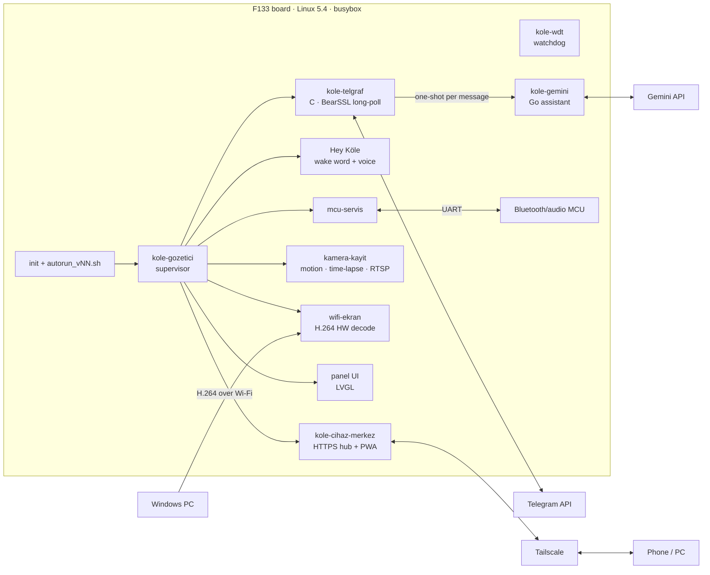

## Boot and flash layout

`boot0` → **TOC1 package**: OpenSBI → U-Boot bridge + DTB → Linux 5.4 → initramfs → `init`.
`init` brings up the screen logo, USB gadget, Wi-Fi (with the power-dip guard) and mounts the SD card, then runs
`autorun_vNN.sh`, which writes the supervisor's config and starts all services.

| Flash offset | Content |
|---|---|
| `0x000000` | boot0 (eGON.BT0) |
| `0x010000` | TOC1 boot package (OpenSBI, U-Boot bridge + DTB, kernel, initramfs) |
| `0xC00000` | `/data` (JFFS2): keys, Wi-Fi, settings |
| `0xFE0000` | UDISK (small FAT kept from the stock firmware) |

If the flash ever fails to boot, an **SD FEL switch** (16 KB on an SD card) forces USB FEL mode for re-flashing —
see [firmware/README.md](firmware/README.md).

## Components

| Program | Language | Role |
|---|---|---|
| `kole-gemini` | Go | Assistant: Gemini Q&A, TTS, Telegram handling, news/weather/currency, health, OOM, time-lapse, photo frame |
| `kole_telgraf` | C + BearSSL | Telegram long-poll; queue of outgoing messages to several chats |
| `kole_gozetici` | C | Supervisor: start, restart, back-off, logs |
| `kole_wdt` | C | Hardware watchdog feeder (memory-locked) |
| `kole_cihaz_merkez` | C | Device hub: HTTP API, PWA, camera/recordings, audit log |
| `kole_tlsvekil` | C + BearSSL | TLS proxy in front of the hub |
| `kamera_kayit` | C | USB camera: frames, motion, recording, time-lapse, RTSP |
| `kole_kopru` | C | Bridge between panel, camera and audio |
| `kole_asistan` | C | Voice front-end: wake word, recording, playback |
| `wifi_ekran` | C | PC second-screen receiver (Cedar VE H.264 + G2D) |
| `mcu_servis` | C | UART owner for the Bluetooth/audio MCU, heartbeat |
| `amfi_bekci` | C | Amplifier gate (speaker on only while playing) |
| `vl` | C | Multi-call tools: boot logo, framebuffer, MCU, pin monitor |
| `panel` | C + LVGL | Touch UI |
| probes (`*_prova`, `*_olc`, `cedar_yokla`, …) | C | Hardware experiments kept for reference |

## Engineering notes

Lessons from fitting all of this into 64 MB:

1. **Memory is the product.** Telegram long-poll lives in a tiny C process; Go starts per message. Tailscale runs
   with `GOMEMLIMIT=8MiB` (about 12 → 5 MB). zram, CMA sizing and Wi-Fi RX pool tuning keep camera, hub and VPN
   alive together. Lowering `min_free_kbytes`/watermarks made things *worse* — fragmentation, not size, was the killer.
2. **One TLS connection, kept open.** Opening a new TLS connection per request starved the CPU (35 % idle);
   keep-alive brought it to 86 % idle.
3. **Wi-Fi start can brown out the board.** The radio's inrush current resets the SoC on a weak power supply about
   1 s after the driver loads. Wi-Fi start is guarded: a crash during start skips Wi-Fi on the next boot and retries
   later, instead of boot-looping.
4. **The MCU has a heartbeat.** The Bluetooth/audio MCU resets the SoC if it is not answered for ~10 s — so its
   service starts early, and FEL work needs it quiet.
5. **A RAM test boot does not prove a flash boot.** Two kernels booted fine from RAM over FEL and failed from flash;
   always keep a recovery path (SD FEL switch) before writing flash.
6. **Measure, don't guess.** After two failures: stop and instrument. (Logging uptime to the SD card every 0.5 s found
   the Wi-Fi brown-out.)
7. **Version every file on the device** (`name_vN`), never overwrite in place.

## Repository layout

| Folder | Content |
|---|---|
| [`go/kole-gemini/`](go/kole-gemini) | Go assistant (standard library only; static RISC-V build) with unit tests |
| [`device/src/`](device/src) | C services and tools (see [Components](#components)) |
| [`device/initramfs/`](device/initramfs) | `init`, Wi-Fi start/save, FEL entry, DHCP script, zram |
| [`device/sd/`](device/sd) | SD card scripts: `autorun`, Tailscale start, Wi-Fi watchdog, memory tuning, MCU service |
| [`panel/`](panel) | Touch panel UI (LVGL 9.2, framebuffer + evdev, G2D) |
| [`kernel/`](kernel) | Kernel config, device trees, small driver overlay |
| [`patches/`](patches) | Tailscale low-memory watchdog patch |
| [`scripts/`](scripts) | Build scripts (WSL Ubuntu 22.04 + RISC-V toolchain) |
| [`pc/`](pc) | PC tools: serial shell, install over serial, safe reboot, FEL SPI-NOR flasher (+ tests), SD FEL switch, Telegram notifier |
| [`firmware/`](firmware) | Flash backup, boot package, SD FEL switch, vendor dumps, Tina SDK reference |
| [`docs/images/`](docs/images) | Screenshots used here |

## Building and installing

1. **Toolchain** (WSL Ubuntu 22.04): a `riscv64-linux-gnu` cross compiler, Go (standard library only), the kernel
   tree from the Allwinner Tina SDK. Build scripts in [`scripts/`](scripts) follow the author's folder layout — set
   `VELINUX_ROOT` and adjust paths. Example: `scripts/681_build_kole_gemini_v51_v1.sh` runs `gofmt`, `go vet`,
   `go test` and a static RISC-V build.
2. **Serial console:** `python pc/f133_seri_v5.py komut "echo; uname -a" 5 --port=COM5` (needs `pip install pyserial`).
3. **Install a file to the SD card** over serial (checked by SHA-256):
   `python pc/com_kur_v12.py <local_file>=<sd_name>=<sha256>`.
4. **Secrets** live only on the device in `/data/...` (mode 0600): Gemini key, Telegram token, Tailscale state, Wi-Fi.
   `pc/sir_com_yaz_v1.py` writes one over serial without echoing it. Nothing secret is in this repository.
5. **Flash / recover:** see [firmware/README.md](firmware/README.md).

Code comments and identifiers are mostly Turkish. This is a hobby project for one specific board; expect to adapt it.

## Safety rules

- Send only **documented** MCU commands; some undocumented ones change persistent settings or start firmware updates.
- Do not change persistent MCU settings without a way back (one wrong command muted the speaker until it was undone).
- Back up the whole flash, verify by double read and write the header sector last.
- Keep the SD FEL switch at hand before any flash write.

## By the numbers

51 versions of the assistant · 65 boot scripts · ~680 build and measurement scripts · 200+ measured experiments ·
built in about three weeks with a lot of help from AI coding agents.

---

# Türkçe

**İçindekiler:** [Nedir](#nedir) · [Özellikler](#özellikler) · [Donanım](#donanım) · [Mimari](#mimari) ·
[Açılış ve flash](#açılış-ve-flash-düzeni) · [Bileşenler](#bileşenler) · [Mühendislik notları](#mühendislik-notları) ·
[Depo düzeni](#depo-düzeni) · [Derleme ve kurulum](#derleme-ve-kurulum) · [Güvenlik](#güvenlik-kuralları) ·
[Rakamlarla](#rakamlarla)

## Nedir

Kart, uygun fiyatlı bir Allwinner **F133** akıllı ekran (1600×600 dokunmatik ekran, USB kamera, hoparlör, Bluetooth
ses yongası). Kapalı bir **Melis** RTOS firmware'iyle geliyordu. VeLinux bu firmware'in yerine, karttaki 16 MB
SPI-NOR flash'tan açılan özel bir **Linux 5.4** sistemi koyuyor ve yaklaşık **55 MB kullanılabilir RAM**'de eksiksiz
bir ev asistanı çalıştırıyor — kendi bulut sunucusu yok, ek donanım yok.

Her şey cihazın üzerinde çalışır: Telegram botu, sesli asistan, kamera kaydı, web Merkez ve dokunmatik arayüz.
Dışarıdan kullanılanlar yalnız çağrılan API'ler (Gemini, Telegram, hava/döviz/haber) ve uzaktan erişim için
Tailscale'dir. Windows PC isteğe bağlıdır: "ikinci ekran" kaynağı ve masaüstü yardımcısı olarak kullanılabilir.

## Özellikler

### 🎙️ Sesli asistan — "Hey Köle"
- Cihazda uyandırma sözcüğü ("Hey Köle"), ardından kayıt ve sesli cevap.
- Cevaplar **Gemini**'den gelir; birkaç model yarıştırılır, meşgul bir model cevabı bekletmez.
- Seslendirme Gemini TTS ile; günlük kota dolunca yedek olarak **ElevenLabs**.
- Konuşma başlamadan amfinin uyanması için kısa bir ön tampon.
- Kişilik: asistan "Köle"dir ve kibarca ("efendim") cevap verir.

### 💬 Telegram botu
Kalıcı düğme menüsü ve komutlar:

| Komut | Ne yapar |
|---|---|
| `/menu` | Düğme menüsünü gösterir |
| `/durum` | Hava, kamera ve hizmet durumu |
| `/foto` | Anlık fotoğraf |
| `/canli` | Canlı kamera bağlantısı |
| `/bekci` | Bekçi modu: hareket bildirimi |
| `/zaman` | Time-lapse (zaman atlamalı çekim) |
| `/cerceve` | Dijital fotoğraf çerçevesi |
| `/haber` | Haberler (siber güvenlik özeti dahil) |
| `/sabah` | Sabah özeti |
| `/saglik` | Cihaz sağlığı |
| `/ses` | Ses ve hoparlör ayarları |
| `/heykole` | Uyandırma dinlemesini aç/kapat |
| `/sehir` | Hava durumu şehri |
| `/jp` | Bir belge/web sayfası hakkında soru (yalnız o sayfadan cevap, ilgili bölümün bağlantısıyla) |
| `/yardim` | Tüm komutlar ve örnekler |

- Düz yazı asistana sorudur; cevaplar menüyü açık tutar.
- Ek kullanıcılar (ör. aile) için **izin listesi**: herkes kendi sohbetinde cevap alır, önemli uyarılar herkese gider.
- Sağlık, bellek yetersizliği (OOM) ve hareket uyarıları kendiliğinden gönderilir.
- 64 MB için tasarlandı: küçük bir C süreci **BearSSL** ile Telegram uzun sorgusunu açık tutar; Go asistan yalnız her
  mesajda başlar ve çıkar.

### 📷 Kamera
- Hareket algılamalı USB kamera (dakika başına hareket puanı), bekçi modunda fotoğraflı uyarı.
- SD karta parça parça kayıt, **time-lapse** (seçilebilir aralık, 30 gün saklanır), fotoğraf çerçevesi kipi.
- Özet (digest) kimlik doğrulamalı **RTSP** sunucusu; Telegram'da, Merkez'de ve PWA'da canlı izleme.
- Gizlilik kalkanı: kamera ve mikrofon panelden kilitlenebilir; her izleme denetim günlüğüne yazılır.

### 🖐️ Dokunmatik panel arayüzü
C ile **LVGL 9.2** kullanılarak doğrudan framebuffer üzerinde yazıldı (G2D döndürme, X/Wayland yok). Sekmeler:
**Pano** (saat, hava, döviz, durum) · **Medya** (PC medya tuşları, Bluetooth telefon) · **Kısayollar** · **Asistan** ·
**Zamanlayıcı** · **Notlar** · **Monitör** (işlemci/bellek) · **PC Sistem** (canlı PC bilgisi) · **PC Ekranı** ·
**Gizlilik** · **Ayarlar**. Aşağı çekilen denetim merkezi, temalar (kırmızı/siyah, mavi, beyaz), gece modu, panel
kilidi, ekran koruyucular (saat, logo, bilgi, kelime, dünya, yıldız, aurora) ve hareketli "robot gözler".

### 🌐 Merkez — web ve PWA
- Cihazda çalışan HTTPS Merkez (küçük bir C sunucusunun önünde BearSSL TLS vekili).
- **Tailscale** ile her yerden erişilir — ev internetinin **CGNAT** arkasında olmasına rağmen. Telefon mobil
  verideyken trafik çoğu zaman aktarıcıdan (DERP) geçer; bu yüzden canlı görüntü "çek" biçimindedir: telefon kareyi
  tek tek ister, gecikme birikmez.
- Telefona **PWA** olarak kurulur: cihaz sağlığı, kamera, kayıtlar, time-lapse oynatıcı, olaylar, ayarlar.
- Kullanıcı adı + parola ile giriş, kamera/kayıtlar için ayrı parola, her erişim denetim günlüğünde.

### 🖥️ PC ikinci ekran ve yardımcı
- PC, Wi-Fi üzerinden **H.264** gönderir; F133'ün **donanım video motoru (Cedar VE)** çözer, G2D ekrana döndürür.
  Bellek ve tampon ayarlarından sonra 6,9 → 19,8 kare/sn ölçüldü.
- Panel canlı PC bilgilerini gösterir ve medya tuşları gönderir; Windows yardımcı uygulaması ("PC Merkez") cihaz
  durumunu, time-lapse'i ve güncellemeleri gösterir. *(Windows uygulamaları bu depoda yoktur.)*

### 🛡️ Kendini toparlama
- **Gözetici** (`kole-gozetici`) tüm hizmetleri tek ayardan başlatır ve gerekirse yeniden başlatır.
- **Donanım bekçisi** (`kole-wdt`): ölürse kart ~16 sn'de resetlenir.
- **Wi-Fi bekçisi** `wpa_supplicant`/DHCP'yi yeniden başlatır; **güç koruması**, zayıf adaptörde radyonun ani akım
  çekişi kartı resetlediğinde açılış döngüsünü önler.
- Bellek yetersizliği olayları çekirdek günlüğünden okunup Telegram'a bildirilir.
- Cihaza kurulan her dosyanın adında sürüm vardır; geri dönmek tek bir ad değişikliğidir.

## Donanım

| Parça | Ayrıntı |
|---|---|
| İşlemci | Allwinner **F133** — XuanTie C906 RISC-V ~1 GHz, kılıf içinde **64 MB DDR2** |
| Depolama | **16 MB SPI-NOR** (açılış + `/data`), microSD (hizmetler, kayıtlar) |
| Ekran | 1600×600 dokunmatik (framebuffer dikey 600×1600; arayüz yatay çizilip döndürülür) |
| Görüntü | Cedar VE donanım çözücü, G2D 2B motoru |
| Wi-Fi | SDIO üzerinden SSV6006 |
| Bluetooth / ses | UART'ta ayrı Bluetrum MCU (115200 8N1), kalp atışlı çerçeve protokolü |
| Diğer | USB kamera, hoparlör + amfi, mikrofon, USB (seri konsol ve FEL kipi) |

## Mimari

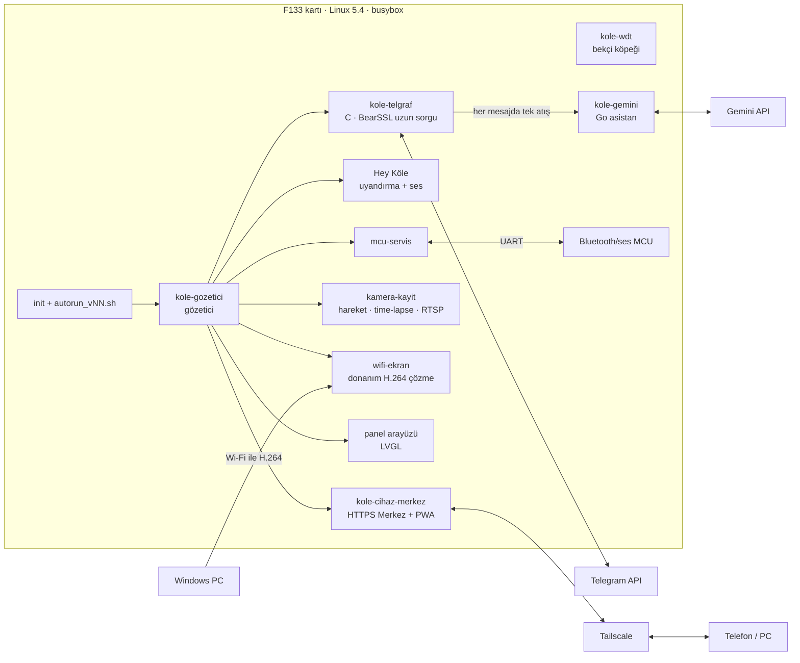

## Açılış ve flash düzeni

`boot0` → **TOC1 paketi**: OpenSBI → U-Boot köprüsü + DTB → Linux 5.4 → initramfs → `init`.
`init` açılış logosunu, USB gadget'ı, Wi-Fi'yi (güç korumasıyla) açar ve SD kartı bağlar; ardından gözeticinin
ayarını yazıp tüm hizmetleri başlatan `autorun_vNN.sh`'ı çalıştırır.

| Flash adresi | İçerik |
|---|---|
| `0x000000` | boot0 (eGON.BT0) |
| `0x010000` | TOC1 açılış paketi (OpenSBI, U-Boot köprüsü + DTB, çekirdek, initramfs) |
| `0xC00000` | `/data` (JFFS2): anahtarlar, Wi-Fi, ayarlar |
| `0xFE0000` | UDISK (özgün firmware'den kalan küçük FAT) |

Flash açılmazsa SD karttaki 16 KB'lık **SD FEL anahtarı** kartı USB FEL kipine sokar ve yeniden yazılabilir —
bkz. [firmware/README.md](firmware/README.md).

## Bileşenler

| Program | Dil | Görevi |
|---|---|---|
| `kole-gemini` | Go | Asistan: Gemini soru-cevap, TTS, Telegram işleme, haber/hava/döviz, sağlık, OOM, time-lapse, çerçeve |
| `kole_telgraf` | C + BearSSL | Telegram uzun sorgusu; birden çok sohbete giden mesaj kuyruğu |
| `kole_gozetici` | C | Gözetici: başlatma, yeniden başlatma, geri çekilme, günlük |
| `kole_wdt` | C | Donanım bekçisini besler (belleğe kilitli) |
| `kole_cihaz_merkez` | C | Merkez: HTTP API, PWA, kamera/kayıtlar, denetim günlüğü |
| `kole_tlsvekil` | C + BearSSL | Merkez'in önündeki TLS vekili |
| `kamera_kayit` | C | USB kamera: kare, hareket, kayıt, time-lapse, RTSP |
| `kole_kopru` | C | Panel, kamera ve ses arasındaki köprü |
| `kole_asistan` | C | Ses ön ucu: uyandırma, kayıt, çalma |
| `wifi_ekran` | C | PC ikinci ekran alıcısı (Cedar VE H.264 + G2D) |
| `mcu_servis` | C | Bluetooth/ses MCU'sunun UART sahibi, kalp atışı |
| `amfi_bekci` | C | Amfi kapısı (hoparlör yalnız çalarken açık) |
| `vl` | C | Çok çağrılı araçlar: açılış logosu, framebuffer, MCU, pin izleme |
| `panel` | C + LVGL | Dokunmatik arayüz |
| denemeler (`*_prova`, `*_olc`, `cedar_yokla`, …) | C | Başvuru için saklanan donanım deneyleri |

## Mühendislik notları

Bunların hepsini 64 MB'a sığdırırken öğrendiklerimiz:

1. **Bellek her şeydir.** Telegram uzun sorgusu küçük bir C sürecinde; Go her mesajda başlar. Tailscale
   `GOMEMLIMIT=8MiB` ile çalışır (~12 → 5 MB). zram, CMA boyutu ve Wi-Fi alma havuzu ayarı kamera, Merkez ve VPN'i
   birlikte ayakta tutar. `min_free_kbytes`/su seviyelerini düşürmek işi *kötüleştirdi* — sorun boyut değil,
   parçalanmaydı.
2. **Tek TLS bağlantısı, açık tutulur.** Her istekte yeni TLS bağlantısı işlemciyi boğuyordu (%35 boşta);
   bağlantıyı açık tutmak %86 boşa çıkardı.
3. **Wi-Fi açılışı kartı resetleyebilir.** Zayıf adaptörde radyonun ani akım çekişi, sürücü yüklendikten ~1 sn sonra
   kartı resetler. Wi-Fi açılışı korunur: açılış sırasında çökme olursa sonraki açılışta Wi-Fi atlanır ve sonra
   yeniden denenir; açılış döngüsü olmaz.
4. **MCU'nun kalp atışı var.** Bluetooth/ses MCU'su ~10 sn cevap alamazsa kartı resetler — bu yüzden hizmeti erken
   başlar ve FEL işleri sırasında MCU susturulmalıdır.
5. **RAM provası flash açılışını kanıtlamaz.** İki çekirdek FEL ile RAM'den açıldı ama flash'tan açılmadı; flash'a
   yazmadan önce mutlaka bir kurtarma yolu (SD FEL anahtarı) hazır olsun.
6. **Tahmin etme, ölç.** İki başarısızlıktan sonra dur ve ölç. (SD karta 0,5 sn'de bir çalışma süresi yazmak Wi-Fi
   çöküşünü buldu.)
7. **Cihazdaki her dosyaya sürüm ver** (`ad_vN`); yerinde üzerine yazma.

## Depo düzeni

| Klasör | İçerik |
|---|---|
| [`go/kole-gemini/`](go/kole-gemini) | Go asistan (yalnız standart kütüphane; statik RISC-V), birim testleriyle |
| [`device/src/`](device/src) | C hizmetleri ve araçları (bkz. [Bileşenler](#bileşenler)) |
| [`device/initramfs/`](device/initramfs) | `init`, Wi-Fi başlatma/kaydetme, FEL girişi, DHCP betiği, zram |
| [`device/sd/`](device/sd) | SD betikleri: `autorun`, Tailscale başlatma, Wi-Fi bekçisi, bellek ayarı, MCU hizmeti |
| [`panel/`](panel) | Dokunmatik arayüz (LVGL 9.2, framebuffer + evdev, G2D) |
| [`kernel/`](kernel) | Çekirdek ayarı, aygıt ağaçları, küçük sürücü eki |
| [`patches/`](patches) | Tailscale düşük bellek bekçi yaması |
| [`scripts/`](scripts) | Derleme betikleri (WSL Ubuntu 22.04 + RISC-V araç zinciri) |
| [`pc/`](pc) | PC araçları: seri kabuk, seriden kurulum, güvenli yeniden başlatma, FEL SPI-NOR yazıcı (+ testler), SD FEL anahtarı, Telegram bildirici |
| [`firmware/`](firmware) | Flash yedeği, açılış paketi, SD FEL anahtarı, üretici dökümleri, Tina SDK referansı |
| [`docs/images/`](docs/images) | Buradaki ekran görüntüleri |

## Derleme ve kurulum

1. **Araç zinciri** (WSL Ubuntu 22.04): `riscv64-linux-gnu` çapraz derleyici, Go (yalnız standart kütüphane),
   Allwinner Tina SDK çekirdek ağacı. [`scripts/`](scripts) içindeki betikler yazarın klasör düzenine göredir —
   `VELINUX_ROOT`'u ayarlayın ve yolları uyarlayın. Örnek: `scripts/681_build_kole_gemini_v51_v1.sh`; `gofmt`,
   `go vet`, `go test` ve statik RISC-V derlemesi yapar.
2. **Seri konsol:** `python pc/f133_seri_v5.py komut "echo; uname -a" 5 --port=COM5` (`pip install pyserial` gerekir).
3. **SD karta dosya kurma** (seri üzerinden, SHA-256 doğrulamalı):
   `python pc/com_kur_v12.py <yerel_dosya>=<sd_adi>=<sha256>`.
4. **Sırlar** yalnız cihazda `/data/...` altında (0600) durur: Gemini anahtarı, Telegram jetonu, Tailscale durumu,
   Wi-Fi. `pc/sir_com_yaz_v1.py` bir sırrı ekrana yansıtmadan seri üzerinden yazar. Bu depoda hiçbir sır yoktur.
5. **Flash / kurtarma:** bkz. [firmware/README.md](firmware/README.md).

Kod yorumları ve adlar çoğunlukla Türkçedir. Bu, belirli bir kart için yapılmış bir hobi projesidir; başka donanımda
uyarlama gerekir.

## Güvenlik kuralları

- MCU'ya yalnız **belgelenmiş** komutları gönderin; bazı belgesiz komutlar kalıcı ayarları değiştirir ya da firmware
  güncellemesi başlatır.
- Geri dönüş yolu olmadan kalıcı MCU ayarı değiştirmeyin (yanlış bir komut hoparlörü, geri alınana kadar susturdu).
- Flash'ın tamamını yedekleyin, çift okumayla doğrulayın, başlık sektörünü en son yazın.
- Flash'a yazmadan önce SD FEL anahtarını hazır bulundurun.

## Rakamlarla

Asistanın 51 sürümü · 65 açılış betiği · ~680 derleme ve ölçüm betiği · 200'den fazla ölçülmüş deney ·
yaklaşık üç haftada, yapay zekâ kodlama ajanlarının yoğun yardımıyla yapıldı.

---

# Screenshots / Ekran görüntüleri

### Measured improvements / Ölçülen iyileştirmeler

<picture>
  <source media="(prefers-color-scheme: dark)" srcset="docs/images/olcumler-koyu.svg">
  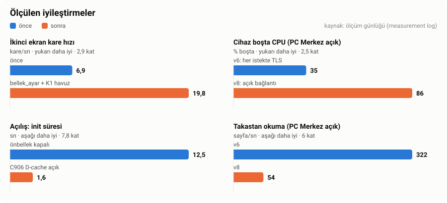
</picture>

### Robot eyes and video / Robot gözler ve video

The assistant's face: the panel screen saver and the "Hey Köle" listening face (blink, look around, happy, hearts,
angry, sleepy, red when the camera is on). / Asistanın yüzü: panel koruyucusu ve "Hey Köle" dinleme yüzü (kırpma,
etrafa bakma, mutlu, kalp, kızgın, uykulu, kamera açıkken kırmızı).

**▶ [Project video, 1 minute (MP4) / Tanıtım videosu, 1 dakika (MP4)](docs/media/velinux-kole-tanitim.mp4)** —
title, robot eyes, panel tabs, Merkez PWA, PC Merkez and the measured results. / başlık, robot gözler, panel
sekmeleri, Merkez PWA, PC Merkez ve ölçülen sonuçlar.

### Touch panel / Dokunmatik panel

Themes, tabs and settings — 1600×600 screen. / Temalar, sekmeler ve ayarlar — 1600×600 ekran.

  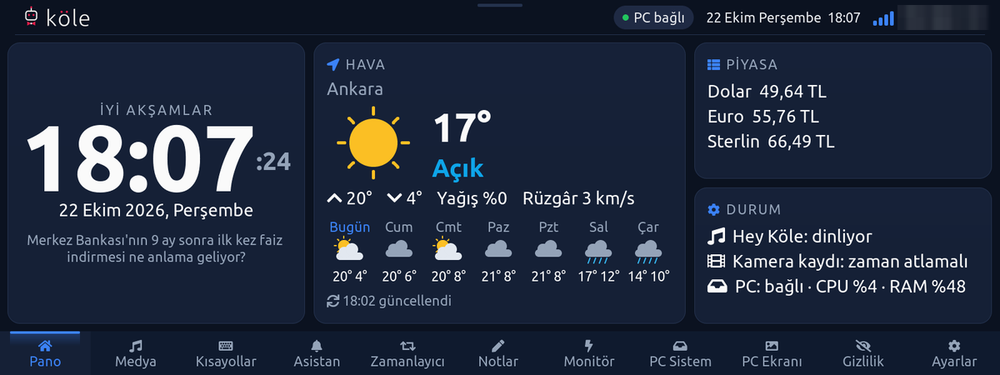
  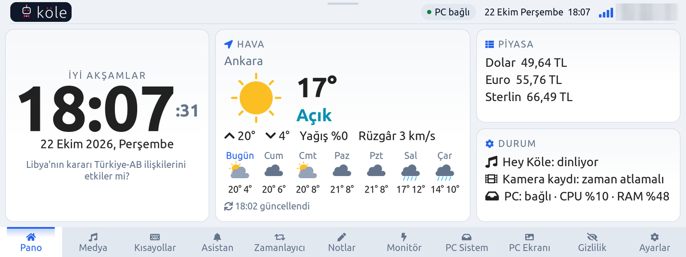 
  Blue and white themes / Mavi ve beyaz temalar  
  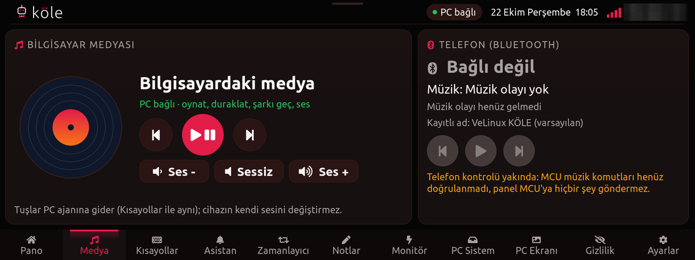
  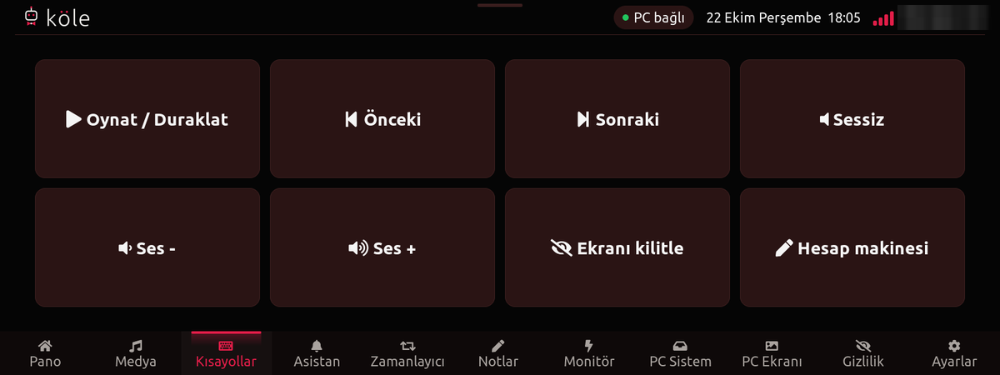 
  Media (PC + Bluetooth phone) and Shortcuts / Medya (PC + Bluetooth telefon) ve Kısayollar  
  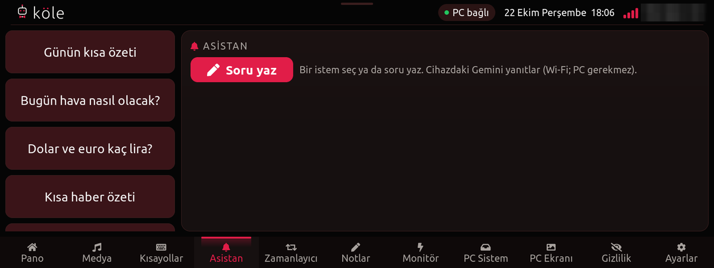
  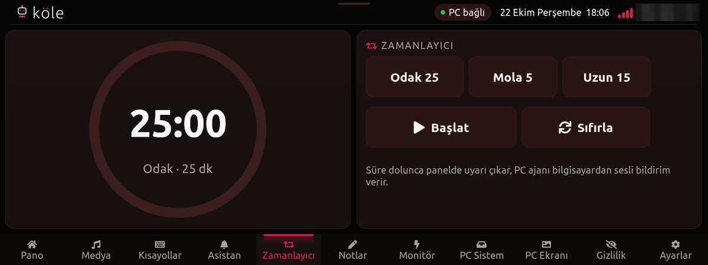 
  Assistant (ask Gemini) and Timer / Asistan (Gemini'ye sor) ve Zamanlayıcı  
  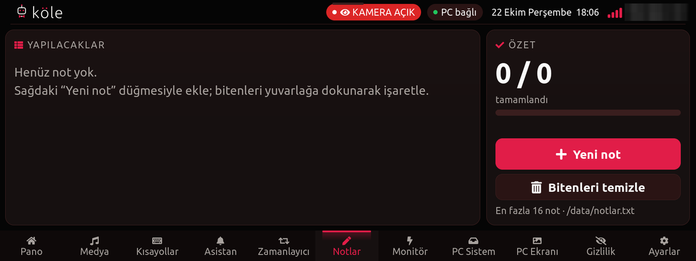
  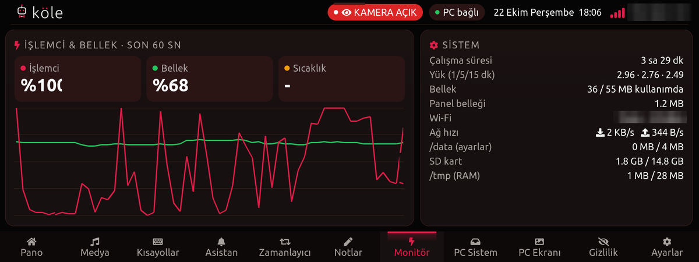 
  Notes and Monitor (CPU / memory) / Notlar ve Monitör (işlemci / bellek)  
  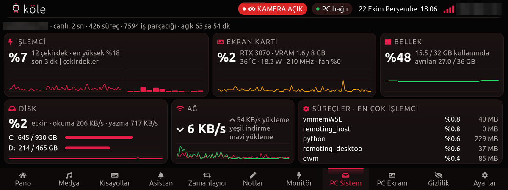
  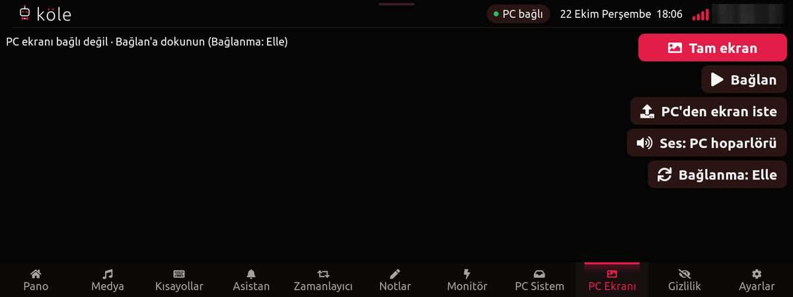 
  Live PC stats and the second-screen receiver / Canlı PC bilgisi ve ikinci ekran alıcısı  
  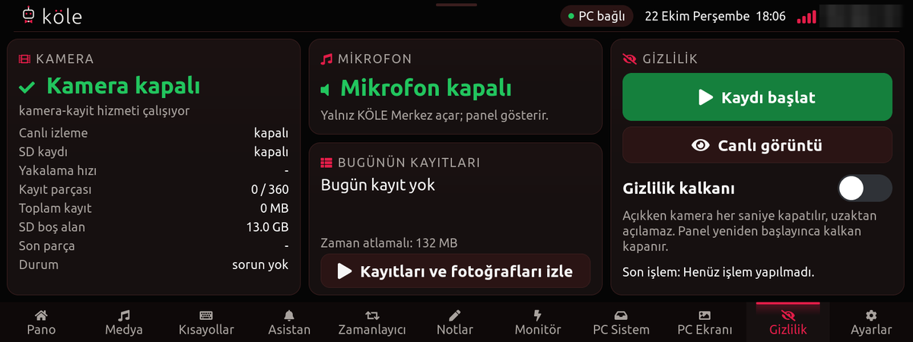
  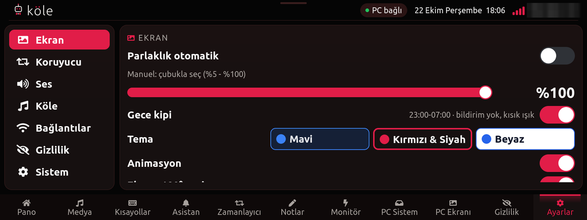 
  Privacy shield and display settings / Gizlilik kalkanı ve ekran ayarları  
  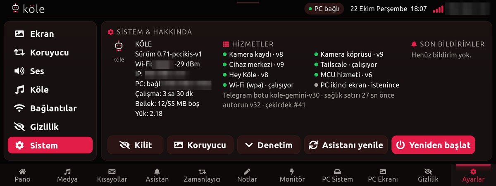
  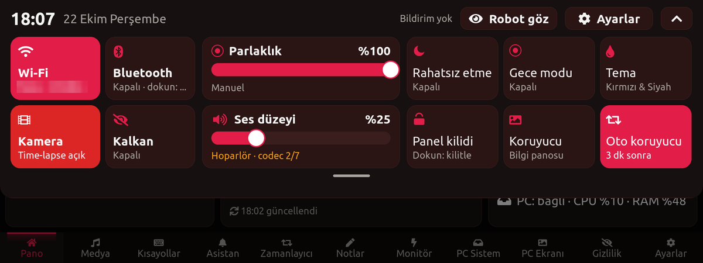 
  System & services, pull-down control center / Sistem ve hizmetler, aşağı çekilen denetim merkezi  
  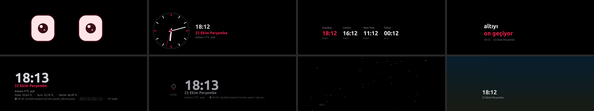 
  Screen savers / Ekran koruyucular

### Merkez PWA

Phone app over Tailscale: login, home, time-lapse, menu. / Tailscale üzerinden telefon uygulaması: giriş, ana sayfa,
time-lapse, menü.

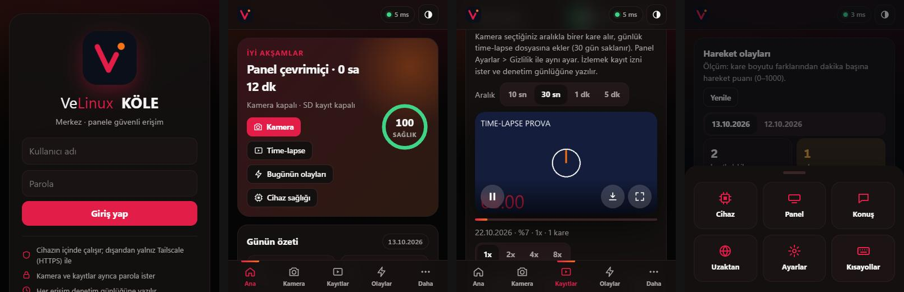

### PC Merkez

Windows companion: device status, time-lapse player, features. / Windows yardımcısı: cihaz durumu, time-lapse
oynatıcı, özellikler.

  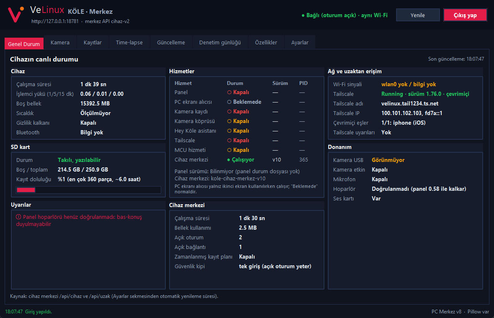 
  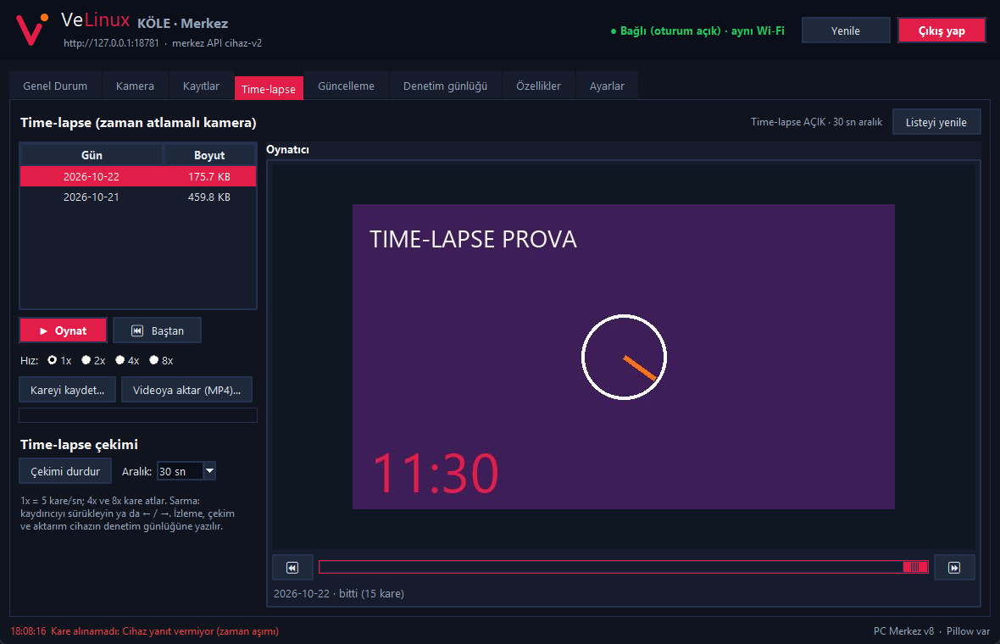
  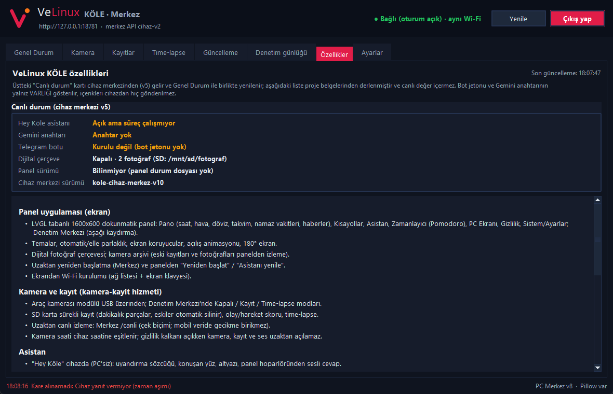

---

## License / Lisans

Source code: **MIT** © 2026 Veli Öztürk — see [LICENSE](LICENSE).
Third-party components (Linux, BearSSL, LVGL, Tailscale, OpenSBI, U-Boot, the Allwinner SDK and the device vendor's
firmware in [`firmware/`](firmware)) keep their own licenses and copyrights.

Kaynak kod: **MIT** © 2026 Veli Öztürk — bkz. [LICENSE](LICENSE). Üçüncü taraf bileşenler (Linux, BearSSL, LVGL,
Tailscale, OpenSBI, U-Boot, Allwinner SDK ve [`firmware/`](firmware) içindeki üretici firmware'i) kendi lisans ve
telif haklarına tabidir.
