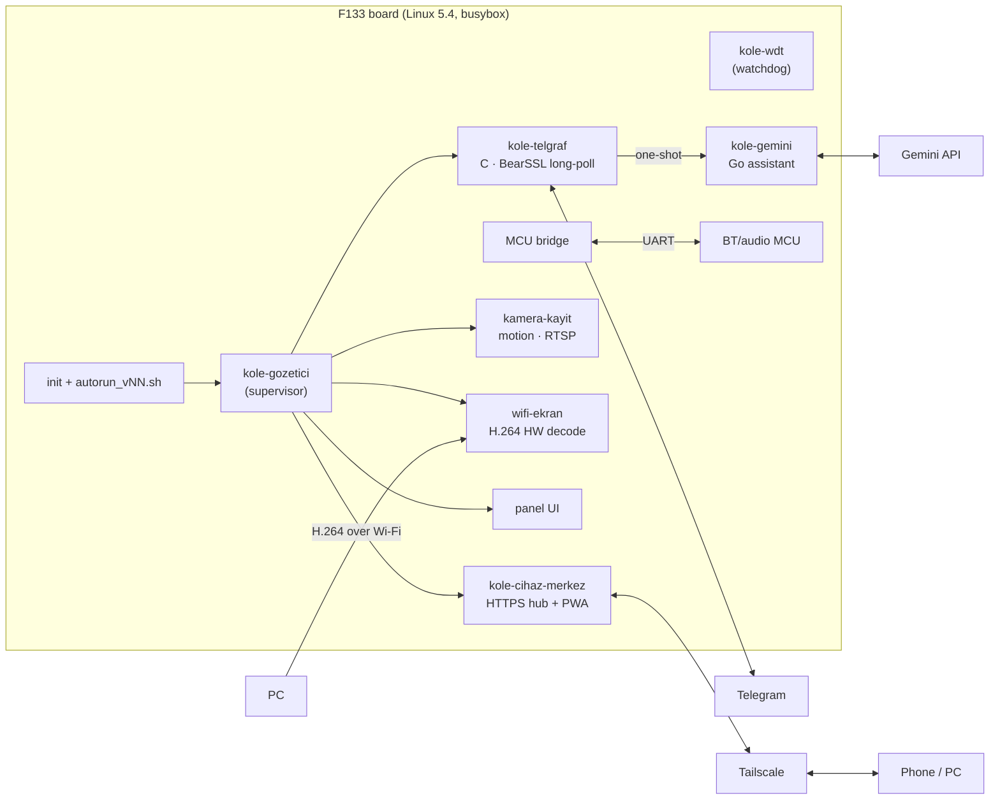

# VeLinux KÖLE

**A cheap F133 smart display, rebuilt from scratch into a Linux voice & Telegram home assistant.**

RISC-V · 64 MB RAM · 16 MB SPI-NOR · Linux 5.4 · Go + C · Gemini · Telegram · Tailscale

[English](#english) · [Türkçe](#türkçe) · [Screenshots](#screenshots) · [Firmware & recovery](firmware/README.md) · MIT

 

---

## English

The board shipped with a closed Allwinner **Melis** RTOS firmware. VeLinux replaces it with a custom Linux that
boots from the 16 MB SPI-NOR and runs a complete home assistant in about **56 MB of usable RAM**:

- 🎙️ **"Hey Köle" voice assistant** — on-device wake word, Gemini answers, spoken replies (Gemini TTS with ElevenLabs fallback)
- 💬 **Telegram bot** — persistent menu, camera photos, live view, alerts, multi-user allow-list, document Q&A (`/jp`)
- 📷 **Camera** — motion alerts, recording to SD, RTSP
- 🖥️ **PC second screen** — the PC streams H.264, the F133 **hardware video engine** decodes it
- 🌐 **"Merkez" web hub + PWA** — HTTPS dashboard over Tailscale, reachable from anywhere (works behind CGNAT)
- 🖐️ **Touch panel UI** — clock, weather/currency/news board, settings, 180° mounting
- 🛡️ **Self-healing** — supervisor, hardware watchdog, Wi-Fi watchdog, OOM alerts, power-dip guard for Wi-Fi start

### Architecture

### Hardware

| | |
|---|---|
| SoC | Allwinner F133 (XuanTie C906 RISC-V, 64 MB DDR2 in package) |
| Storage | 16 MB SPI-NOR, microSD |
| Wireless | SSV6006 SDIO Wi-Fi; separate Bluetooth/audio MCU on UART |
| I/O | touch display, camera, speaker + amplifier, USB (serial console / FEL) |

### How it boots

`boot0` → **TOC1 package** (OpenSBI → U-Boot bridge + DTB → Linux 5.4 → initramfs) → `init` mounts the SD card and
runs `autorun_vNN.sh`, which starts the services through the supervisor. If anything goes wrong, an **SD FEL switch**
puts the board into USB FEL mode for re-flashing — see [firmware/README.md](firmware/README.md).

### Engineering notes

Things learned the hard way, on 64 MB:

- **Memory is the product.** The Telegram long-poll runs in a tiny C process (BearSSL); the Go assistant only starts
  for each update and exits. Tailscale runs with `GOMEMLIMIT=8MiB`. zram plus careful pool sizing keep the camera,
  hub and VPN alive together.
- **Wi-Fi start can brown out the board.** The radio's inrush current resets the SoC on a weak supply, so Wi-Fi start
  is guarded: a crash during start skips Wi-Fi on the next boot and retries later instead of boot-looping.
- **The MCU has a heartbeat.** The UART MCU resets the SoC if it is not answered for ~10 s, so the bridge comes up
  early and FEL work needs the MCU quiet.
- **Version every file on the device.** Every installed change gets a new name (`name_vN+1`), so the previous version
  is always one rename away.
- **Measure before retrying.** Two failures → stop and instrument (logging uptime to SD every 0.5 s found the brown-out).

### Repository layout

| Folder | Content |
|---|---|
| [`go/kole-gemini/`](go/kole-gemini) | Go assistant (standard library only; static RISC-V build) with tests |
| [`device/src/`](device/src) | C services: supervisor, watchdog, Telegram, HTTPS hub, camera, second screen, MCU bridge |
| [`device/initramfs/`](device/initramfs) | `init`, Wi-Fi start/save, FEL entry, DHCP script |
| [`device/sd/`](device/sd) | SD scripts: `autorun`, Tailscale start, Wi-Fi watchdog, memory tuning |
| [`panel/`](panel) | Touch panel UI (framebuffer / G2D) |
| [`kernel/`](kernel) | Kernel config, device trees, driver overlay |
| [`patches/`](patches) | Tailscale low-memory watchdog patch |
| [`scripts/`](scripts) | Build scripts (WSL Ubuntu 22.04 + RISC-V toolchain; set `VELINUX_ROOT`) |
| [`pc/`](pc) | PC tools: serial shell, install over serial, reboot, FEL flasher, SD FEL switch, Telegram notifier |
| [`firmware/`](firmware) | Flash backup, boot package, SD FEL switch, vendor dumps, Tina reference |

### Getting started

1. **Build** (WSL): cross toolchain for `riscv64`, then e.g. `scripts/681_build_kole_gemini_v51_v1.sh` (Go: `go test` + static build).
2. **Install** a binary to the SD card over serial: `python pc/com_kur_v12.py <local>=<sd_name>=<sha256>` (needs `pyserial`).
3. **Secrets** live only on the device in `/data/...` (mode 0600) — Gemini key, Telegram token, Tailscale state.
   Nothing secret is in this repository.
4. **Recover** a bricked board: [firmware/README.md](firmware/README.md#recovery-board-does-not-boot).

Code comments and identifiers are mostly Turkish. This is a hobby project for one specific board; expect to adapt it.

### Measured improvements

<picture>
  <source media="(prefers-color-scheme: dark)" srcset="docs/images/olcumler-koyu.svg">
  
</picture>

### Screenshots

**Touch panel** — themes, tabs and settings (1200×450 panel)

  
   
  
   
  
   
  
   
  
   
  
   
  
   
  

**Merkez PWA** — the phone app over Tailscale: login, home, time-lapse, more menu

**PC Merkez** — Windows companion app: device status, time-lapse player, features

   
  
  

### By the numbers

51 versions of the assistant · 65 boot scripts · ~680 build/measurement scripts · 200+ measured experiments ·
built with a lot of help from AI coding agents.

---

## Türkçe

Bu kart kapalı bir Allwinner **Melis** RTOS firmware'iyle geliyordu. VeLinux onun yerine 16 MB SPI-NOR'dan açılan özel
bir Linux kuruyor ve **~56 MB kullanılabilir RAM**'de eksiksiz bir ev asistanı çalıştırıyor:

- 🎙️ **"Hey Köle" sesli asistan** — cihazda uyandırma sözcüğü, Gemini cevapları, sesli yanıt (Gemini TTS, yedek ElevenLabs)
- 💬 **Telegram botu** — kalıcı menü, kamera fotoğrafı, canlı görüntü, uyarılar, çok kullanıcılı izin listesi, belgeye soru (`/jp`)
- 📷 **Kamera** — hareket uyarısı, SD'ye kayıt, RTSP
- 🖥️ **PC ikinci ekran** — PC H.264 gönderir, F133'ün **donanım video motoru** çözer
- 🌐 **Merkez web + PWA** — Tailscale üzerinden HTTPS pano, her yerden erişim (CGNAT arkasında da)
- 🖐️ **Dokunmatik panel** — saat, hava/döviz/haber, ayarlar, 180° montaj
- 🛡️ **Kendini toparlama** — gözetici, donanım bekçisi, Wi-Fi bekçisi, bellek uyarıları, Wi-Fi açılışında güç koruması

**Açılış:** `boot0` → TOC1 paketi (OpenSBI → U-Boot köprü + DTB → Linux 5.4 → initramfs) → `init` SD'yi bağlar,
`autorun_vNN.sh` hizmetleri gözetici ile başlatır. Kart açılmazsa **SD FEL anahtarı** ile USB'den yeniden yazılır
([firmware/README.md](firmware/README.md)).

**Öğrendiklerimiz:** 64 MB'ta bellek her şeydir (C ile Telegram, Go tek atış, Tailscale 8 MiB); zayıf adaptörde Wi-Fi
radyosu kartı resetler, bu yüzden açılışta korunur; MCU'nun kalp atışı ~10 sn cevapsız kalırsa kartı resetler; cihazdaki
her değişen dosya yeni sürüm adı alır; iki başarısızlıktan sonra durup ölçülür.

Sırlar (API anahtarı, jeton, parola) depoda yoktur; yalnız cihazda `/data` altında (0600) durur.

## License

Source code: **MIT** © 2026 Veli Öztürk — see [LICENSE](LICENSE).
Third-party components (Linux, BearSSL, Tailscale, OpenSBI, U-Boot, Allwinner SDK and the device vendor's firmware in
[`firmware/`](firmware)) keep their own licenses and copyrights.
